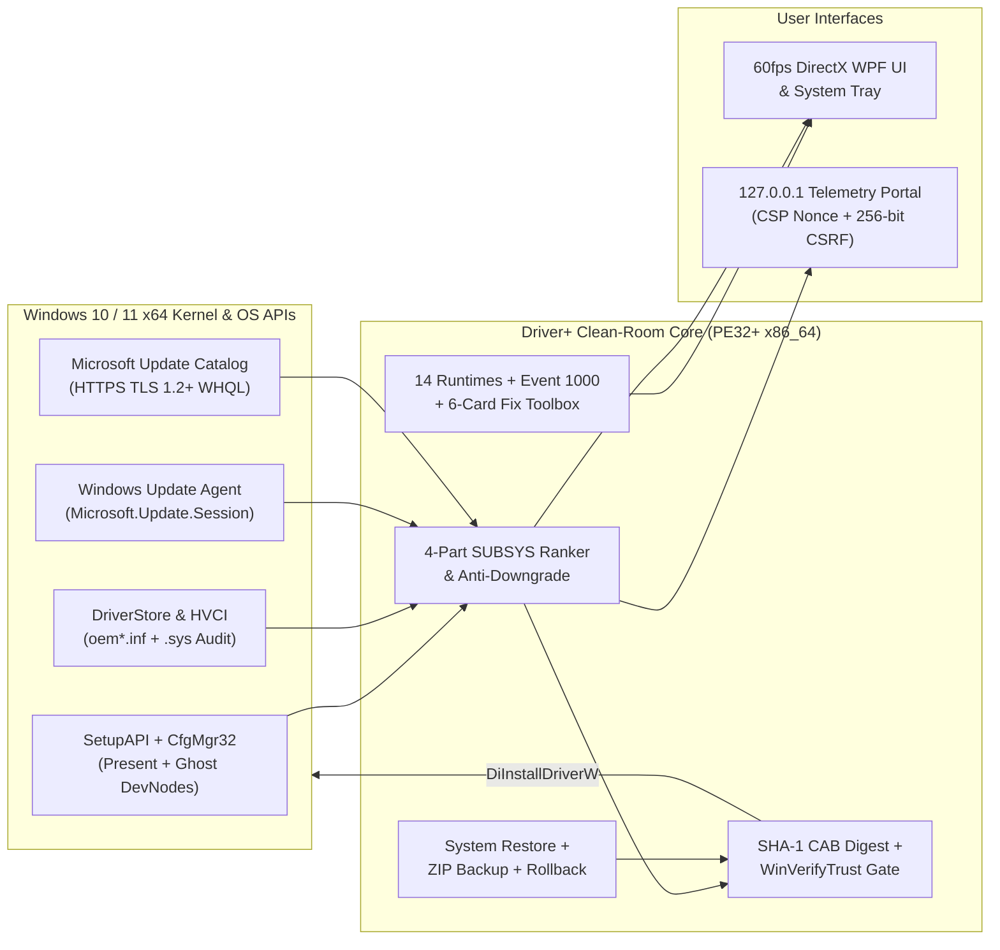

<p align="center">
  
</p>

<h1 align="center">Driver+</h1>

<p align="center">
  <strong>Clean-room, native 64-bit (<code>PE32+</code>) official WHQL hardware driver updater, game runtime doctor, rescue center &amp; Windows 11 HVCI auditor for Windows 10 &amp; Windows 11.</strong>
</p>

<p align="center">
  <a href="https://github.com/sshihabb007/DriverPlus/releases/latest">
    
  </a>
  
  
  
  <a href="LICENSE">
    
  </a>
</p>

**Driver+** is a fast, lightweight (`~266 KB` portable executable, zero third-party NuGet dependencies, zero background resident bloatware, zero telemetry) open-source Windows hardware &amp; driver management suite. Every update candidate is resolved exclusively from **local Windows Update Agent (`Microsoft.Update.Session`)** and the **live Microsoft Update Catalog (`catalog.update.microsoft.com`)**, verified against embedded **40-hex SHA-1 CAB digests** and **`WinVerifyTrust` Authenticode signatures** before touching `newdev.dll!DiInstallDriverW`.

---

## Key Features &amp; Engineering Highlights

### 1. Native 64-Bit Hardware &amp; Unplugged Ghost Inventory (`SetupAPI` + `CfgMgr32`)
- Enumerates all present and disconnected ("ghost") Plug-and-Play devices in a single native 64-bit pass via `SetupDiGetClassDevsW`, `CM_Locate_DevNodeW`, and `CM_Get_DevNode_Status` (`DN_HAS_PROBLEM` / `DN_PRIVATE_PROBLEM`) with zero 32-bit `WOW64` thunking overhead.
- **OEM 4-Part `SUBSYS` Specificity &amp; Anti-Downgrade Engine**: Ranks exact 4-part board/laptop Hardware IDs (`PCI\VEN_xxxx&DEV_yyyy&SUBSYS_zzzzzzzz`) above generic 2-part silicon IDs (`PCI\VEN_xxxx&DEV_yyyy`), blocks foreign-OEM `SUBSYS` cross-pollination, and prevents accidental version downgrades.
- Built-in **PCI / USB Silicon &amp; OEM Subsystem Vendor Resolver** (`Intel`, `AMD`, `NVIDIA`, `Realtek`, `Qualcomm`, `MediaTek`, `Broadcom`, `ASUS`, `Lenovo`, `Dell`, `HP`, `MSI`, `Acer`, `Gigabyte`, and more) with verified `https://` vendor support portals.

### 2. 100% Official WHQL Update Pipeline &amp; Cryptographic Supply-Chain Gate
- **Dual Official Update Sources**:
  1. **Local Windows Update Agent COM (`Microsoft.Update.Session`)** — `IsInstalled=0 and Type='Driver'`
  2. **Live Microsoft Update Catalog (`https://www.catalog.update.microsoft.com`)** — Concurrent TLS 1.2+ queries filtered to the exact host OS family (Windows 11 vs. Windows 10).
- **4-Stage Pre-Install Security Gate**:
  1. Strict `https://` allowlist (`*.windowsupdate.com` / `*.microsoft.com`) re-validated across HTTP redirects, plus a `1.5 GiB` CAB download ceiling.
  2. Mandatory **40-hex SHA-1 digest** verification against Microsoft's content-addressed CAB filename before extraction.
  3. **`WinVerifyTrust` (`WINTRUST_ACTION_GENERIC_VERIFY_V2`) Authenticode verification** on extracted `.cat` security catalogs and `.sys` kernel binaries.
  4. Atomic installation via native 64-bit `newdev.dll!DiInstallDriverW` with explicit reboot-required tracking.

### 3. 14 Game Runtimes &amp; Event ID 1000 Crash DLL Doctor
- Audits installation state, registry versions, and system binaries across **14 essential gaming &amp; developer redistributables**:
  - Microsoft Visual C++ `2010`, `2012`, `2013`, and `2015–2022` (`x86` &amp; `x64`)
  - DirectX End-User Runtimes (`d3dx9_43.dll`, `xinput1_3.dll`, `xaudio2_7.dll`)
  - `.NET Framework 4.8+` &amp; `.NET Desktop Runtime 8 / 9 (x64)`
  - OpenAL (`OpenAL32.dll`), NVIDIA PhysX System Software, and Microsoft Build of OpenJDK (`x64`)
- **Application Crash DLL Doctor**: Inspects Windows Application Event Log (`Event ID 1000`) faulting module entries (e.g., `vcruntime140_1.dll`, `msvcp140.dll`, `d3dx9_43.dll`, `xinput1_3.dll`, `OpenAL32.dll`) and maps crashes directly to official `winget` package IDs and vendor `https://` installers.

### 4. Rescue Center, Driver Rollback &amp; Air-Gapped Offline Profiles
- **System Restore Checkpoints**: Creates Windows System Restore points (`srclient.dll!SRSetRestorePointW`, `DEVICE_DRIVER_INSTALL`) prior to driver modifications.
- **DriverStore `.zip` Backups**: Exports installed `oem*.inf` packages into timestamped `.zip` archives accompanied by `.sha256` integrity sidecars and guarded against Zip-Slip path traversal on restore.
- **One-Click Driver Rollback**: Invokes `newdev.dll!DiRollbackDriver` to revert problematic driver updates cleanly.
- **Air-Gapped Offline Hardware Profiles**: Exports full hardware &amp; DriverStore inventories to portable `.json` profiles on offline machines and imports them on internet-connected workstations to resolve official WHQL packages safely.

### 5. 6-Card Hardware Fix Toolbox &amp; Windows 11 HVCI Blocker Auditor
- **Fix No Sound**: Inspects CoreAudio `MMDeviceEnumerator` + `IAudioEndpointVolume` mute/scalar volume state, verifies the `Audiosrv` service, unmutes muted endpoints, and plays a verification chime.
- **Device Error Code `1–52` &amp; `HRESULT` Doctor**: Translates `CfgMgr32` problem codes (`CM_PROB_*`) and `SetupAPI` `0x800Fxxxx` / `0xE000xxxx` codes into actionable root causes and triggers `CM_Reenumerate_DevNode` hardware resets.
- **Unplugged USB &amp; HID Ghost Cleaner**: Identifies stale non-present devnodes and removes selected ghosts via `CM_Uninstall_DevNode`.
- **Network Stack &amp; DNS Refresh**: Executes `System32\ipconfig.exe /flushdns` and refreshes network adapter devnodes.
- **Display Mode Reset**: Queries `EnumDisplaySettingsW(ENUM_REGISTRY_SETTINGS)` and restores clean desktop resolution/refresh timings via `ChangeDisplaySettingsExW`.
- **Windows 11 Memory Integrity (HVCI) Auditor**: Cross-checks installed `DriverStore` OEM `.sys` drivers against HVCI / Vulnerable Driver Blocklist rules so users can pinpoint exact packages blocking Core Isolation.

### 6. Crash-Safe Game Boost &amp; Loopback Web Telemetry Console
- **Crash-Safe Power &amp; Service Boost**: Writes a recovery snapshot (`boost-snapshot.json`) to disk **before** switching to the `High Performance` power scheme (`PowrProf.dll!PowerSetActiveScheme`) so interrupted sessions can always restore the exact pre-boost power plan and service state.
- **Fullscreen Direct3D Focus Guard**: Polls `shell32.dll!SHQueryUserNotificationState` (`QUNS_RUNNING_D3D_FULL_SCREEN` / `QUNS_BUSY`) to suppress notifications while gaming or presenting.
- **60fps DirectX WPF Desktop UI + Loopback Web Portal**: Hardware-accelerated dark glassmorphic desktop interface (`VirtualizingStackPanel` recycling, Windows 11 DWM dark titlebar &amp; rounded corners, system tray mode) paired with an optional `127.0.0.1` web telemetry dashboard protected by `Host`/`Origin` DNS-rebinding checks, per-response CSP nonces, and 256-bit CSRF tokens.

---

## Architecture &amp; Security Overview



- **Interactive Architecture Walkthrough**: Open [`docs/architecture.html`](docs/architecture.html) in any browser for animated packet flows and layer inspection, or read [`docs/spec.md`](docs/spec.md) for the full clean-room specification.
- **Least-Privilege Execution (`asInvoker`)**: Launches unprivileged for fast hardware scanning, update discovery, HVCI auditing, and offline profile export; requests UAC elevation (`runas` with `--relaunch` mutex handoff) only when you explicitly initiate a driver install, rollback, or system repair.
- **PE32+ Binary Hardening**: Compiled as native `x86_64` with `DYNAMIC_BASE` (ASLR), `HIGH_ENTROPY_VA` (64-bit ASLR), `NX_COMPAT` (DEP), `NO_SEH`, `PerMonitorV2` DPI awareness, and zero embedded debug/PDB path leakage.

---

## Measured Footprint &amp; Performance

Measured on a live Windows 11 x64 laptop (`12th Gen Intel Core i5-12450HX`, `293` total PnP devnodes — `214` present / `79` unplugged ghosts, `195` OEM DriverStore INF packages, `14` runtimes):

| Metric | Legacy Commercial Updaters (Typical) | **Driver+ `v1.0.0` (x64)** |
| :--- | :--- | :--- |
| **Process Architecture** | 32-bit `PE32` (`WOW64`) + multiple background services | **Native 64-bit `PE32+` (`x86_64`)**, `0` background daemons |
| **Disk Footprint** | `200 MB – 300 MB+` (`600+` files) | **`266.0 KB`** Portable EXE / **`162.5 KB`** Setup Wizard |
| **Memory Usage (Full Scan)** | `~195 MB+` idle across resident tray/service helpers | **`42.3 MB`** warm / **`48.2 MB`** cold private memory |
| **Full Live WHQL Scan Latency** | Proprietary cloud scan | **`2.75 s`** warm / **`13.0 s`** cold (WUA + live MS Update Catalog) |
| **Third-Party Dependencies** | Bundled Chromium/CEF, proprietary DLLs, ad SDKs | **`0` NuGet packages** (100% inbox Windows `.NET 4.x` + Win32 P/Invoke) |

---

## Installation

### Option 1: Native x64 Setup Wizard *(Recommended)*

1. Download **`DriverPlus-Setup-1.0.0-x64.exe`** from the [**Latest GitHub Release**](https://github.com/sshihabb007/DriverPlus/releases/latest).
2. Run the installer, choose your install folder (defaults to `%LOCALAPPDATA%\Programs\DriverPlus` — no Administrator rights required to install), and optionally enable Desktop / Start Menu shortcuts.
3. Uninstall cleanly anytime from **Windows Settings &gt; Installed Apps** or via `Uninstall.exe` inside the install folder.

### Option 2: Zero-Install Portable Executable

1. Download **`DriverPlus-Portable-1.0.0-x64.exe`** from the [**Latest GitHub Release**](https://github.com/sshihabb007/DriverPlus/releases/latest).
2. Run it directly from any folder or USB rescue drive — zero installation required.

### Option 3: Build &amp; Verify from Source *(Zero External Dependencies)*

Requires only Windows 10 or Windows 11 (`x64`) with the built-in `.NET Framework 4.x` compiler (`C:\Windows\Microsoft.NET\Framework64\v4.0.30319\csc.exe`):

```powershell
git clone https://github.com/sshihabb007/DriverPlus.git
cd DriverPlus

# Run the 16-suite TDD unit + live hardware integration test harness
powershell -NoProfile -ExecutionPolicy Bypass -File .\test.ps1

# Compile Portable EXE + Setup Wizard EXE, run --self-test, and verify sandbox install/uninstall
powershell -NoProfile -ExecutionPolicy Bypass -File .\build.ps1 -SkipDesktopCopy
```

Build outputs are emitted to `dist\DriverPlus-Portable-1.0.0-x64.exe` and `dist\DriverPlus-Setup-1.0.0-x64.exe`.

---

## Command-Line Reference

### Application (`DriverPlus.exe`)

| Command | Description |
| :--- | :--- |
| `DriverPlus.exe` | Launch the 60fps DirectX WPF desktop application |
| `DriverPlus.exe --minimized` | Launch minimized directly to the Windows System Tray |
| `DriverPlus.exe --self-test` | Execute all 8 non-destructive hardware, HVCI, runtime &amp; security self-checks |
| `DriverPlus.exe --self-test --out report.txt` | Write self-test verification results to `report.txt` |
| `DriverPlus.exe --scan-json scan.json` | Export full hardware + live Microsoft Update Catalog report as JSON |
| `DriverPlus.exe --scan-json scan.json --offline` | Export local hardware + WUA + DriverStore JSON report without network queries |
| `DriverPlus.exe --serve-ui --port 17890` | Start the hardened `127.0.0.1` loopback web telemetry console |

### Setup Wizard &amp; Uninstaller (`DriverPlus-Setup-1.0.0-x64.exe` / `Uninstall.exe`)

| Command | Description |
| :--- | :--- |
| `DriverPlus-Setup-1.0.0-x64.exe` | Launch interactive dark-themed x64 Setup Wizard |
| `DriverPlus-Setup-1.0.0-x64.exe --silent` | Silent per-user install to `%LOCALAPPDATA%\Programs\DriverPlus` (alias: `/S`) |
| `DriverPlus-Setup-1.0.0-x64.exe --silent --install-dir "C:\Tools\DriverPlus"` | Silent install to a custom target folder |
| `Uninstall.exe --uninstall --silent` | Silent clean removal of owned Driver+ files, shortcuts &amp; registry entry |

---

## Project Layout

```text
DriverPlus/
├── .github/workflows/            # Windows x64 CI test gate & tagged Release automation
├── assets/
│   ├── driverplus.ico            # Multi-resolution Windows icon (16px..256px)
│   └── driverplus.png            # High-DPI application badge
├── docs/
│   ├── architecture.html         # Interactive single-file HTML architecture walkthrough
│   ├── spec.md                   # Clean-room functional & security specification
│   └── plan.md                   # Engineering & verification blueprint
├── installer/
│   └── DriverPlusSetupWizard.cs  # Native x64 Setup Wizard & owned-file Uninstaller
├── scripts/
│   └── generate_icon.py          # Deterministic multi-size ICO/PNG asset generator
├── src/
│   ├── app.manifest              # amd64 + PerMonitorV2 DPI + least-privilege asInvoker
│   ├── Program.cs                # Entry point, single-instance mutex & CLI modes
│   ├── Core/
│   │   ├── DriverModels.cs       # Domain models & immutable scan/install contracts
│   │   ├── DriverVersionComparer.cs # 4-part SUBSYS specificity & anti-downgrade engine
│   │   ├── PciVendorResolver.cs  # PCI/USB silicon + OEM SUBSYS vendor lookup
│   │   └── ProblemCodeCatalog.cs # CfgMgr32 CM_PROB 1..52 + SetupAPI HRESULT catalog
│   ├── Native/
│   │   └── NativeMethods.cs      # 64-bit Win32 P/Invoke (SetupAPI, CfgMgr32, newdev, WinTrust, PowrProf, SRClient, DWM)
│   ├── Services/
│   │   ├── PnpDeviceScanner.cs           # Single-pass live & ghost PnP enumerator
│   │   ├── DriverStoreInspector.cs       # oem*.inf inventory & Windows 11 HVCI auditor
│   │   ├── WindowsUpdateCatalogClient.cs # Local WUA COM + live MS Update Catalog client
│   │   ├── DriverInstallOrchestrator.cs  # SHA-1 + WinVerifyTrust + DiInstallDriverW pipeline
│   │   ├── RescueBackupService.cs        # System Restore, ZIP backup/restore & offline profiles
│   │   ├── GameRuntimeInspector.cs       # 14 runtimes + Event ID 1000 Crash DLL Doctor
│   │   ├── HardwareFixService.cs         # 6-card audio/network/display/device/HVCI repair suite
│   │   ├── GameBoostService.cs           # Crash-safe PowrProf boost & fullscreen D3D guard
│   │   ├── SystemInfoService.cs          # Hardware profile collector & Markdown/JSON exporter
│   │   ├── SettingsService.cs            # Atomic local JSON settings persistence
│   │   └── LocalWebPortalServer.cs       # Loopback 127.0.0.1 CSP-nonce + CSRF telemetry server
│   └── UI/
│       ├── MainWindow.cs         # Virtualized 60fps DirectX WPF desktop studio
│       ├── TrayIconManager.cs    # System tray integration & D3D focus-aware notifications
│       └── ThemeTokens.cs        # Dark glassmorphic design palette & typography tokens
├── tests/
│   └── DriverPlusTests.cs        # 16-suite unit, security boundary & live hardware tests
├── build.ps1                     # Full x64 build, self-test & sandbox installer smoke pipeline
├── test.ps1                      # Standalone x64 TDD test runner
├── CHANGELOG.md                  # Curated release changelog
└── LICENSE                       # MIT License
```

---

## Author &amp; Developer

- **Name:** Mehedi Hasan Shihab (`@sshihabb007`)
- **Role:** Software &amp; Systems Engineer
- **GitHub:** [github.com/sshihabb007](https://github.com/sshihabb007)
- **Portfolio:** [sshihabb007.github.io](https://sshihabb007.github.io/)
- **LinkedIn:** [linkedin.com/in/mehedi-hasan-shihab](https://www.linkedin.com/in/mehedi-hasan-shihab)
- **Email:** `sshihabb007@gmail.com`

---

## License

Licensed under the [MIT License](LICENSE).
